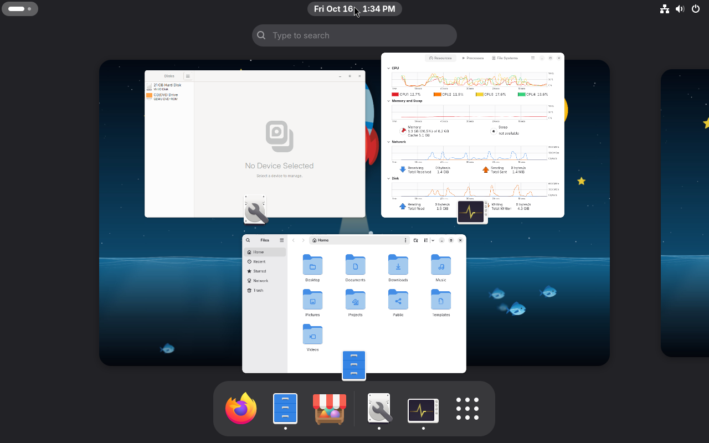
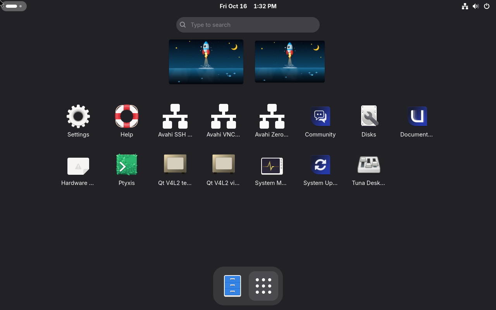
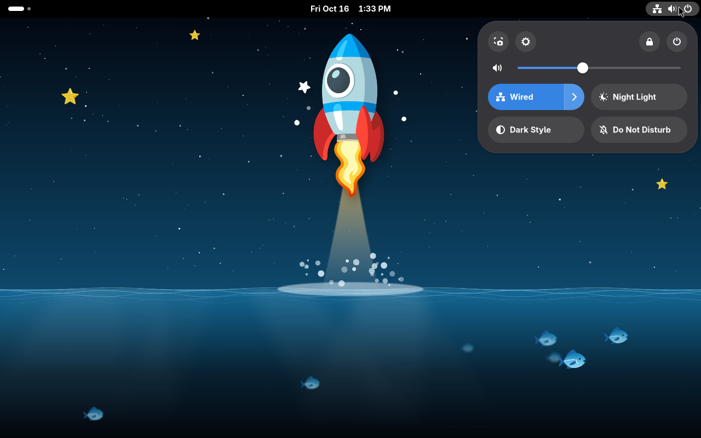
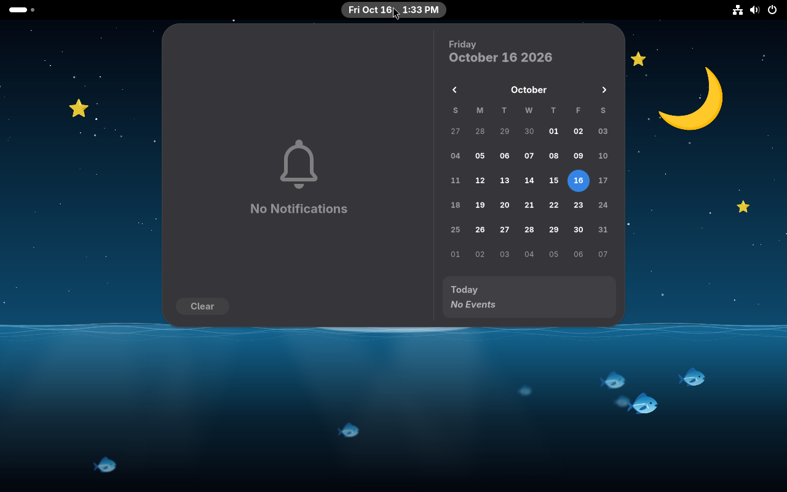
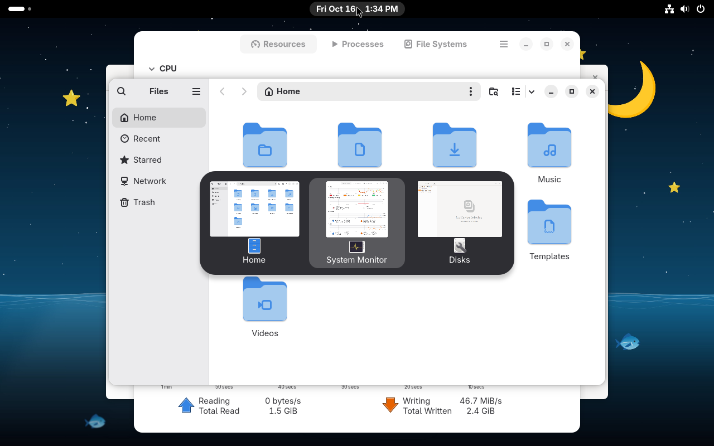
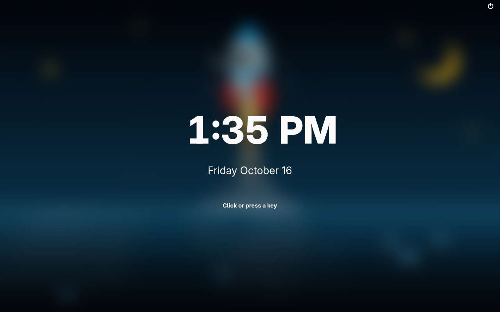
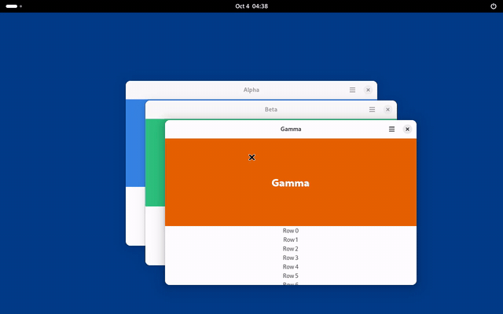

# Tuna Desktop

Formerly **Roost**. Binaries, packages, crates and environment variables were renamed in [#505](https://github.com/tuna-os/tuna-desktop/issues/505); the old `roost-*` names keep working for one release (see [packaging/README.md](packaging/README.md)).  <!-- tuna-rename: keep -->

A new, independent Wayland desktop session with a GNOME-inspired everyday workflow. This project is not a GNOME Shell rewrite and does not promise compatibility with GNOME Shell extensions or private Mutter APIs.

The compositor is a long-lived Rust process built with Smithay. The shell UI runs as a supervised Wayland client. The first delivery target is a nested developer preview that can map ordinary applications and recover its shell UI after a shell crash.

Our v1 goal is [GNOME 51 parity plus better responsiveness at matching CPU](docs/v1.md) — the checklist stays public and current there.

<!-- hive-contribute-plea: donated-compute appeal, keep in sync across repos -->
## Contribute compute — no code needed

**[Donate time with your AI CLI](https://hub.tunaos.org/#contribute).**

Your machine runs one task at a time using your signed-in AI coding CLI.
The relay alternates between eligible **School** (OS) and **Reef** (apps)
hives after each task. If one hive has no work, the other can continue.

The guide covers prerequisites, verified `just` setup, credentials, provider
costs, and how to stop with Ctrl+C. Your subscription quota or API charges apply.
Never post account credentials or API keys in issues or pull requests.

## Quickstart

- **Test-drive in a VM (one command):**
  On Linux or macOS, evaluate Tuna Desktop without installing packages or building:

  ```sh
  curl -fsSL https://raw.githubusercontent.com/tuna-os/tuna-desktop/main/scripts/try-tuna-desktop | bash
  ```

  Downloads Corral (checksum-verified), pulls and cosign-verifies the published TunaOS image, and launches Tuna Desktop in local QEMU with a local-only browser console over noVNC. Stop anytime with Ctrl-C. See `scripts/try-tuna-desktop` for options.
- **Install:** [docs/install.md](docs/install.md) covers the Debian-format
  package, building from source and logging in through GDM. The experimental TunaOS
  Marlin image is in [packaging/README.md](packaging/README.md).
- **Try it in a window** inside your current GNOME, Wayland or X11 session,
  from a checkout with the [build prerequisites](docs/development.md#prerequisites):

  ```sh
  git clone https://github.com/tuna-os/tuna-desktop.git
  cd tuna-desktop
  ./scripts/tuna-nested run
  ```

  See [the nested session guide](docs/nested-session.md) for options and
  troubleshooting.

See the [walkthrough](docs/walkthrough.md) for every feature as it looks
today, in frames the GTK shell proof takes on each change.

## Screenshots and overview demo



| App grid | Quick settings |
| --- | --- |
|  |  |

| Calendar | Alt+Tab |
| --- | --- |
|  |  |



These are frames from the real TunaOS Marlin image booted in a QEMU VM by
CI, on its hardware (DRM/KMS) session with the apps the image ships and its
default wallpaper.



[Play or download the overview video (MP4, 12 seconds)](docs/walkthrough/overview-demo.mp4).
The demo shows an actual nested Tuna Desktop session with three libadwaita test windows.
See [capture details](docs/walkthrough/README-media.md) for source revisions and reproduction.

## Project status

**Nested developer preview.** A Smithay compositor supervises a GTK4/libadwaita
shell with overview window previews, app grid and search, quick settings,
notifications, calendar, keyboard navigation and AT-SPI accessibility. Tuna Desktop
also includes its session supervisor, shell host and versioned
control protocol. Floating windows, workspaces, Alt-Tab, half tiling, scrollable
tiling and XWayland are covered by graphical CI journeys.

The DRM/KMS backend starts hardware sessions and is tested with virtual KMS
in CI. Physical GPU, VT, suspend and long-running release qualification remain
open. See [the parity ledger](docs/parity-ledger.md) for measured behavior and
remaining gaps.

**Parity target:** GNOME 51. Native GNOME 51 captures provide the visual
reference. The published Marlin image was verified as GNOME Shell 50.5 on
2026-10-04; a GNOME 51 Marlin benchmark image is being validated separately.

**Target platform:** Tuna Desktop is being tested as a TunaOS Marlin flavor (Arch
base, bootc image). The Debian package remains for local development hosts.

**Roadmap:** tracked as GitHub issues on the Tuna Desktop roadmap project board;
[docs/roadmap.md](docs/roadmap.md) keeps the program structure, gates, and
requirement traceability.

## Prerequisites

- **Rust stable** with `rustfmt` and `clippy` (CI uses the current stable
  toolchain; no MSRV is declared, crates use edition 2021).
- **System libraries**: libseat, libinput, libudev, GBM, libdrm,
  libxkbcommon, GTK 4, libadwaita, PipeWire, Wayland and gtk4-layer-shell
  development files, plus EGL (Mesa llvmpipe is enough) to run a nested
  session. The [development guide](docs/development.md#prerequisites)
  has the exact Ubuntu and Arch package lists CI uses.
- **Spektacular CLI** is needed only for spec and plan work, not for
  building or running Tuna Desktop; see the
  [development guide](docs/development.md#spektacular-cli-planning-work-only).

## Contributing and Development

**Want to contribute?** Start with the [development guide](docs/development.md). It covers:
- Setting up your build environment
- Understanding the project structure
- Running a nested Tuna Desktop session locally ([troubleshooting](docs/nested-session.md#troubleshooting))
- [Running tests locally](docs/testing.md), the same checks CI runs
- [Spektacular workflows](docs/development.md#understanding-spektacular-workflows) for planning and tracking

## Documentation

- [Program architecture](docs/architecture.md)
- [Program roadmap and requirement traceability](docs/roadmap.md)
- [Parent requirement register](docs/requirements.md)
- [Verification and test strategy](docs/test-strategy.md)
- [Parity ledger](docs/parity-ledger.md)
- [Research intake rules](docs/research/README.md)
- [Architecture decisions](docs/adr/README.md)
- [Contributing](CONTRIBUTING.md)

## License

GPL-3.0-or-later. See [LICENSE](LICENSE).

The [public roadmap](docs/roadmap.md#public-roadmap) records priorities through October 2027, current release limits and contribution opportunities.
