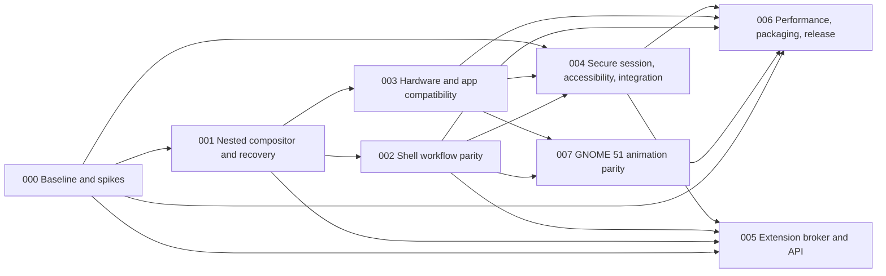
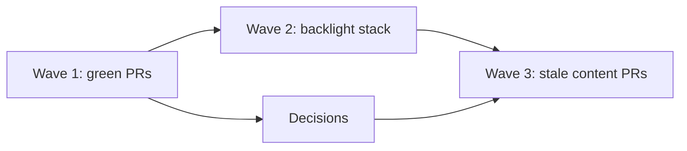

# Tuna Desktop roadmap and traceability

This page holds the [public 12-month roadmap](#public-roadmap) (dated priorities, release status, adoption evidence and contribution opportunities) and the program structure, gates and traceability that follow it.

**Status:** Active. Tier 1 (nested developer preview) is implemented; tier 2 (daily-driver candidate) is open. Work items live as GitHub issues on the [Tuna Desktop roadmap project board](https://github.com/users/hanthor/projects/4); this document keeps the program structure, gates, and traceability.
**Architecture:** [Program architecture](architecture.md)  
**Parity target:** GNOME 51 on the Marlin image family. Decided 2026-10-01. The published Marlin GNOME image measured on 2026-10-04 contains GNOME Shell 50.5, so GNOME 51 comparison evidence must identify its separately upgraded reference payload.
**Target platform:** TunaOS Marlin (Arch Linux base, bootc image), as a Tuna Desktop flavor alongside the GNOME flavor. Reference and candidate run on the same VM image family so comparisons are like for like.  
**Planning system:** Spektacular spec → plan → implement. Every delivery unit has a spek, a reviewed implementation plan, evidence, and an explicit gate.

## Public roadmap

This roadmap covers October 2026–October 2027. Updated 2026-10-08. Tuna Desktop was previously named Roost; the code and packages were renamed in [#505](https://github.com/tuna-os/tuna-desktop/issues/505), while dated evidence keeps the old name ([#504](https://github.com/tuna-os/tuna-desktop/issues/504)). This is the public contribution roadmap; [program gates and requirement traceability](#delivery-tiers) describe the acceptance process. Work and evidence live on the [roadmap board](https://github.com/users/hanthor/projects/4). Dates are planning windows, and release qualification depends on evidence.

### Current status

Tuna Desktop has a nested developer preview, an actual Marlin VM test lane, and a signed experimental amd64 Marlin Tuna Desktop image. The daily-driver candidate remains open. TunaOS merged the flavor, then named Tuna Desktop, in [PR #2991](https://github.com/tuna-os/tunaOS/pull/2991). Its qualified image passed an actual AWS KubeVirt bootc switch, shipped greeter selection and PAM login ([retained evidence](marlin/2026-10-04-flavor-acceptance/README.md)); the installed `0.1.0-2` package is pinned to Tuna Desktop `c28f96eb` and needs a refresh with later fixes before endurance qualification. GNOME 51 remains the comparison baseline. The published Marlin GNOME image measured on 2026-10-04 still contains GNOME Shell 50.5; GNOME 51 comparisons require a separately recorded, fully upgraded reference payload. A build or merged feature alone does not establish parity or release readiness.

The latest GitHub release entry is [v0.0.0-ci, “Demo media bundle”](https://github.com/tuna-os/tuna-desktop/releases/tag/v0.0.0-ci), published 2026-10-01. It contains screenshots and videos, not an installable desktop release. The six session binaries use development package version 0.1.0. The [README](../README.md) now shows real screenshots and an overview recording.

At this update, GitHub reports three contributor entries, zero stars and zero forks. The media release assets have one download in total. Media downloads are not package installs, and none of these counts measures active users. Package-download and installed-user metrics are unavailable; Tuna Desktop does not collect usage telemetry. These dated counts are a starting record, not an adoption claim.

### Direction: GNOME's functionality, better performance

Tuna Desktop aims to do everything GNOME 51 does and to run lighter than GNOME on the same machine. Parity at rest is close: most screens are within 0.1–1.7% of GNOME 51's pixels. Performance is not there yet. On the 2026-10-04 paired Marlin VM run, memory matched GNOME, but median CPU was 159% of a core against GNOME's 19%, and the median overview response was 382 ms against 159 ms. Closing and reversing that gap is a release requirement, tracked in [#503](https://github.com/tuna-os/tuna-desktop/issues/503).

### Next three months: through 2027-01-04

1. Finish and validate the core shell journeys: workspace insertion, app-grid hover/page behavior, notifications, shortcut consent, IME caret placement and live settings interoperability. Keep concrete GNOME differences in the [parity ledger](parity-ledger.md) and pixel comparisons in [GNOME parity captures](gnome-parity.md), with actual graphical acceptance evidence.
2. Complete secure screen sharing and RemoteDesktop integration ([#61](https://github.com/tuna-os/tuna-desktop/issues/61)). Require real GNOME portal consent, authenticated ownership, disconnect and lock revocation, and verified input delivery for each advertised capability.
3. Refresh and qualify the admitted signed amd64 Marlin Tuna Desktop image: current-source package, clean installation, graphical login, portals, PAM, boot and update/rollback evidence. Initial flavor admission and boot/login acceptance are complete ([#69](https://github.com/tuna-os/tuna-desktop/issues/69)); later source fixes and endurance qualification remain open. This scope adds no ISO or LUKS matrix cells.
4. Run the actual 24-hour endurance and comparable performance work ([#203](https://github.com/tuna-os/tuna-desktop/issues/203), [#73](https://github.com/tuna-os/tuna-desktop/issues/73)). Record binary/image provenance, resource growth, frame pacing and failures. Investigate measured regressions before making performance parity claims.
5. Record session lifecycle qualification ([#62](https://github.com/tuna-os/tuna-desktop/issues/62), [#68](https://github.com/tuna-os/tuna-desktop/issues/68)): real VM suspend/resume, VT switching, logout and fail-closed lock behavior, plus the separate physical GPU/driver and mixed-display support matrix. AWS KubeVirt VM evidence covers its own profile only.
6. Port every GNOME 51 animation ([epic #492](https://github.com/tuna-os/tuna-desktop/issues/492), [spec](../.spektacular/specs/20261008122728-6ac4a932-gnome-animation-parity.md)). An audit on 2026-10-08 found 6 of GNOME 51's 54 animations ported and 7 partial. Deliver, in order: GNOME's motion policy (reduced motion keeps fades, slow-down factor) and a deterministic test clock; window open and close; minimize; maximize and tiling; workspace slide and swipe; modal dimming; overview corrections; app grid; menus and transient surfaces; lock screen and desktop transitions. Each family needs a CI gate and a paired GNOME 51 capture, and must cost less CPU than GNOME.
7. Beat GNOME 51 on CPU, frame pacing and overview response on the same Marlin VM ([#503](https://github.com/tuna-os/tuna-desktop/issues/503)). Profile first, then set regression gates ([#315](https://github.com/tuna-os/tuna-desktop/issues/315)).
8. Finish the rename to Tuna Desktop and bring the docs in line with the code: user-facing names ([#504](https://github.com/tuna-os/tuna-desktop/issues/504)), a coordinated internal and package rename ([#505](https://github.com/tuna-os/tuna-desktop/issues/505)), current screenshots ([#506](https://github.com/tuna-os/tuna-desktop/issues/506)) and complete parity-ledger rows for every open GNOME 51 gap ([#507](https://github.com/tuna-os/tuna-desktop/issues/507)).

### Six to twelve months: 2027-04-04–2027-10-04

The next delivery stage is a daily-driver candidate after the security, usability, hardware, recovery and performance gates pass. Architectural work should reduce unnecessary repainting, complete protocol/application compatibility, improve fault recovery and preserve the bounded compositor critical path. A faster benchmark must retain the same workload and measurement scope.

Ecosystem work centers on GTK, Qt and XWayland application journeys; accessible keyboard and screen-reader use; live GNOME settings compatibility; and reliable existing system services. Broader hardware and distribution support should follow a named, reproducible support matrix rather than an untested compatibility claim.

Adoption work should make the qualified amd64 image and its install/recovery instructions usable by external testers, collect reproducible issue reports, and publish the supported configurations and known gaps. Report package download and contributor counts when the publication tools supply them. No numerical active-user target is set without a way to measure it; collect feedback voluntarily and preserve the no-telemetry default.

A 1.0 release requires the [global decision gates](#global-decision-gates). This roadmap does not assign a release date before those gates pass.

### Known limitations and scope

Screen-reader speech, physical GPU/VT/suspend behavior, GPU memory/frame pacing and completed 24-hour endurance are not established by nested graphical tests. Settings support is key-specific; see the [compatibility map](settings-map.md). Modern RemoteDesktop features must remain unadvertised until implemented and tested. Exact visual parity requires paired captures from the declared reference version.

Public extension APIs remain optional later work, outside the initial core release unless scope changes through the recorded decision process. In-process shell extensions, an unbounded plugin authority model and unsupported platform claims are outside this roadmap. No shipped feature deprecation is scheduled; protocol version changes must preserve the documented compatibility contract or explicitly reject incompatible peers.

### Where contributors can help

Useful contributions include reproducible GNOME 51 comparisons, accessibility and language journeys, hardware support reports with exact kernel/GPU/driver/topology, protocol and service failure regressions, comparable performance traces, and packaging/recovery verification. Start from an open [roadmap issue](https://github.com/users/hanthor/projects/4) and identify the acceptance evidence your change supplies.

Use the existing [test strategy](test-strategy.md) and report real runtime failures. Keep unsupported capability advertising, new image/ISO matrix expansion and public extension work out of unrelated fixes. Source tests, screenshots and a successful boot each establish different parts of the release evidence; retain their limits when updating an issue.

## Delivery tiers

The project board's `1 Nested preview`, `2 Daily-driver candidate`, `3 Later`, and `Cross-cutting` values map to [the architecture tiers](architecture.md#delivery-tiers). A merged implementation is not a passed release gate: physical hardware, security, visual comparison and endurance evidence must still be recorded. [ADR 0007](adr/0007-gnome51-marlin-baseline.md) records the baseline and target choices.

## Delivery sequence

Specs 002 and 003 may proceed in parallel after the 001 compositor/control contract is stable. Spec 004 may prototype service/accessibility work earlier, but its production acceptance depends on shell and hardware behavior. Spec 006 is the integration and release dossier. Spec 005 is optional post-core work and is not a prerequisite for 1.0 unless release scope explicitly changes.

## Near-term delivery queue

Ordered by unblocking, from the 2026-10-18 review (119 open issues, 13 open
PRs). Each wave lands before the next starts, so CI failures stay
attributable to one change at a time.

### Wave 1 — merge on green (no code changes needed)

| PR | What | State |
| --- | --- | --- |
| #758 | CI least-privilege tokens + checkout hygiene (closes #623) | CI running |
| #759 | RUSTSEC advisory gate (closes #564) | CI running |
| #719 | Perf: bound overview chrome buffers (draft) | Needs rebase + undraft (owner) |

### Wave 2 — backlight stack, bottom-up (each rebases onto the landed parent)

The brightness/backlight PRs form one stack; merging out of order rebuilds
every child. Land strictly in this order, rebasing each onto its parent:

1. #706 brightness-contract (rebase fixes its ledger failure: the WWAN
   assertions landed on main after the branch)
2. #707 monitor-identity (CONFLICTING — retarget onto landed #706)
3. #708 accelerator-release (retarget onto landed #707; has journey +
   coverage failures to re-evaluate after rebase)
4. #713 native-lifecycle, split 5/5 of #469 (rebase onto main; needs
   lane-owner review + headed VM proof before merge)

#710 (brightness-journal) already landed mid-stack. #713 stays held for
owner review even when green — it binds display lifecycle to kernel
commit completions.

### Wave 3 — stale content PRs (rebase first, then diagnose what remains)

| PR | What | Known state |
| --- | --- | --- |
| #547 | Perf regression gate (draft) | Old journey failure; rebase, then judge |
| #561 | Multitasking prefs (draft) | CONFLICTING; rebase, then judge |
| #458 | GNOME SVG backgrounds (draft) | CONFLICTING; rebase, then judge |
| #453 | Orca native keyboard (draft) | CONFLICTING; rebase, then judge |

### Decisions (blocking Wave 3 and cleanup)

| Issue | Decision needed |
| --- | --- |
| #505 | Confirm v1.0.0-beta.1 counts as the transition release, then schedule tuna-compat removal |
| #737 | 167 Python tests omitted from CI — include, explicitly exclude, or split the suites |
| #733 | Remainder after the token half lands via #758 |
| #564 follow-up | Triage the 8 warnings (zbus/zvariant unmaintained, cgmath unsound) that the new gate leaves advisory |

### v1 milestone mapping

- Milestone 1 (GNOME 51 capabilities): Wave 2 stack, #458, #453.
- Milestone 2 (performance vs GNOME): #719, #547.
- Milestone 3 (provenance/image): #759 (supply chain), image work in tunaos.
- Milestone 4 (checklist): unblocked by Waves 1–3.

### Far-future backlog (post-1.0, not scheduled)

- High-performance GDM replacement: a from-scratch login experience
  matching GDM (fingerprint, smartcard, a11y, i18n, session handoff)
  without the GNOME weight. Deferred: the greeter moves to stock GDM
  for v1, which already provides all of the above.

## Spek and plan registry

| ID | Spek | Purpose | Depends on | Release relationship |
|---|---|---|---|---|
| 000 | [Program baseline and technical spikes](../.spektacular/specs/20260927170316-a01f0010-program-baseline-and-spikes.md) | Baseline GNOME, compare toolkit/accessibility, Smithay/protocol spike, threat model | None | Required evidence before committing major implementation decisions; nested prototype may proceed with provisional assumptions |
| 001 | [Nested compositor and shell recovery](../.spektacular/specs/20260927170317-a01f0011-001-nested-compositor-shell-recovery.md) | First buildable vertical slice; app mapping and supervised shell recovery | 000 inputs | Developer preview foundation |
| 002 | [Shell workflow parity](../.spektacular/specs/20260927170318-a01f0012-shell-workflow-parity.md) | Overview, launcher/search, panel, quick settings, notifications, workspace journeys | 000, 001 | Required for daily-driver candidate |
| 003 | [Hardware and app compatibility](../.spektacular/specs/20260927170319-a01f0013-hardware-and-app-compatibility.md) | DRM/KMS, outputs, XWayland, scaling, IME, data devices, devices and rendering fallbacks | 000, 001 | Required for daily-driver candidate |
| 004 | [Secure session, accessibility, and system integration](../.spektacular/specs/20260927170320-a01f0014-secure-session-accessibility-integration.md) | Lock/auth, portals, AT-SPI journeys, settings and existing services | 000, 001, 002, 003 | Mandatory 1.0 security/usability gate |
| 005 | [Extension broker and public API](../.spektacular/specs/20260927170321-a01f0015-extension-broker-and-api.md) | Capability-limited, out-of-process extensions | 000, 001, 002, 004 | Optional later capability; excluded from initial 1.0 unless explicitly promoted |
| 006 | [Performance, packaging, and release readiness](../.spektacular/specs/20260927170322-a01f0016-performance-packaging-and-release.md) | Benchmarks, CI/conformance, package/rollback and release evidence | 000, 001, 002, 003, 004 | Required for daily-driver candidate |
| 007 | [GNOME 51 animation parity](../.spektacular/specs/20261008122728-6ac4a932-gnome-animation-parity.md) | Every GNOME 51 shell and window animation with GNOME timing and motion preferences, cheaper than GNOME on the same VM ([epic #492](https://github.com/tuna-os/tuna-desktop/issues/492)) | 001, 002, 003 | Required for daily-driver candidate |

The plan store contains `plan.md`, `context.md`, `research.md`, and `test-plan.md` for each unit. Plans are drafts until reviewed against current source, confirmed dependencies, and explicit acceptance evidence. Do not begin implementation from a draft plan if a blocking decision or security boundary is unresolved.

## Requirement traceability

Parent requirements `R1`–`R16` are defined in the
[parent requirement register](requirements.md). A bare `R<n>` in this
document is a parent requirement; a spec's own requirements are written
with their spek number (`001-R5`), per the register's naming rule.

| Parent requirement area | Owning spek(s) | Evidence at completion |
|---|---|---|
| R1 Activities/overview; R2 launch/search; R3 panel/system controls | 002; 004 for service backend | Baseline journeys, recordings, responsiveness/failure cases |
| R4 windows/workspaces/input gestures | 001 foundation; 002 parity; 003 output/input compatibility | lifecycle and focus tests; hotplug and gesture journeys |
| R5 notifications | 002 UI/behavior; 004 service and locked privacy | freedesktop notification matrix, history/actions/DND and locked behavior |
| R6 session/lock | 004 | lock fail-closed, PAM handoff, VT/resume/hotplug fault evidence |
| R7 applications/peripherals | 003; 004 for portal capture | GTK/Qt/XWayland, clipboard, DnD, IME, screen-share consent/revoke |
| R8 accessibility/language | 000 toolkit spike; 002/004 implementation | keyboard/AT-SPI, large text, high contrast, motion, touch, RTL journeys |
| R9 settings interoperability | 004 | published settings compatibility map and migration journey |
| R10 shell failure isolation | 001 | shell kill/restart with app surfaces alive and state resync |
| R11 extension boundary | 005 | quotas, revocation, crash/resource containment/security cases |
| R12 bounded critical path | 001, 002, 005, 006 | tracing and fault tests show no blocking on shell/extensions/search/I/O |
| R13 display correctness | 003, 006 | scale/hotplug/mixed-refresh matrix with measured behavior and fallbacks |
| R14 capture/privileged surfaces | 000 threat model; 003 integration; 004 enforcement; 005 extension denials | spoofing, consent/revoke, unauthorized layer/capture tests |
| R15 recoverable configuration/upgrade | 006 | broken package/config recovery without user-data loss |
| R16 comparable performance | 000 baseline; 006 release comparison; 007 animation cost ([#503](https://github.com/tuna-os/tuna-desktop/issues/503)) | raw comparable traces, variance and soak results |

## Global decision gates

1. **Before 001 implementation:** provisional nested backend, Smithay/protocol versions, event-loop approach, control API envelope, recovery affordance scope, and nested-session safety are recorded. Production same-UID identity remains a release blocker, not a prototype assumption.
2. **Before 002 toolkit lock-in:** toolkit spike demonstrates panel/overview, layer surface, AT-SPI screen reader, IME, RTL, large text, reduced motion, and measured resource/frame behavior.
3. **Before hardware claims:** support matrix names distro, kernel, GPU/driver, output topology, protocol revisions, and tested fallback.
4. **Before secure implementation/release:** threat model assigns trusted identities and lock/auth/portal/capture authority end to end; specialist review has no unresolved critical issue.
5. **Before 1.0:** acceptance of 002, 003, 004, and 006; no critical lock/capture/input/clipboard/IME/accessibility regression; known compositor crash boundary documented; upgrade recovery and benchmark artifacts available.
6. **Before public extensions:** initial use cases map to a small capability set, API compatibility policy and permission UI are reviewed, and all broker containment criteria pass.

## Research intake protocol

GNOME issue reports are leads, not current-state facts. For every issue used to prioritize work, record exact project and issue ID, state, labels, last activity, affected release, reproduction, linked merge request/fix, verification against the pinned baseline, and the Tuna Desktop spek/test that covers it. Do not call an issue unresolved from search snippets. The intake checklist lives in [research intake](research/README.md).

## Change control

- A scope move between developer preview, 1.0, and later requires an ADR with user impact, dependencies, schedule/security impact, and updated traceability.
- A parent requirement change updates owning spek(s), acceptance criteria, roadmap, and plan dependencies together.
- Performance thresholds can change only with repeated comparable evidence and a recorded ADR.
- User-facing parity deviations need severity, owner, rationale, and disposition; undocumented gaps are not accepted as parity.
