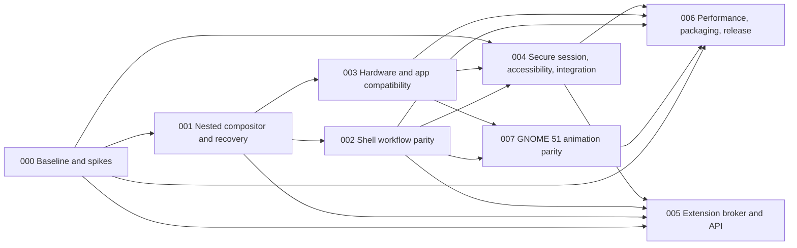

# Tuna Desktop roadmap and traceability

This page holds the [public 12-month roadmap](#public-roadmap) (dated priorities, release status, adoption evidence and contribution opportunities) and the program structure, gates and traceability that follow it.

**Status:** Active. Tier 1 (nested developer preview) is implemented; tier 2 (daily-driver candidate) is open. Work items live as GitHub issues on the [Tuna Desktop roadmap project board](https://github.com/users/hanthor/projects/4); this document keeps the program structure, gates, and traceability.
**Architecture:** [Program architecture](architecture.md)  
**Parity target:** GNOME 51 on the Marlin image family. Decided 2026-10-01. The published Marlin GNOME image measured on 2026-10-04 contains GNOME Shell 50.5, so GNOME 51 comparison evidence must identify its separately upgraded reference payload.
**Target platform:** v1 targets every TunaOS variant, each qualified from its own image digest or explicitly unsupported with a recorded reason ([ADR 0008](adr/0008-v1-beta-track-and-release-scope.md)). Marlin remains the GNOME 51 parity/performance comparator; reference and candidate use the same VM image family.
**Planning system:** Spektacular spec → plan → implement. Every delivery unit has a spek, a reviewed implementation plan, evidence, and an explicit gate.

## Public roadmap

This roadmap covers October 2026–October 2027. Updated 2026-10-19. Tuna Desktop was previously named Roost; the code and packages were renamed in [#536](https://github.com/tuna-os/tuna-desktop/pull/536), while dated evidence keeps the old name ([#504](https://github.com/tuna-os/tuna-desktop/issues/504)). This is the public contribution roadmap; [program gates and requirement traceability](#delivery-tiers) describe the acceptance process. Work and evidence live on the [roadmap board](https://github.com/users/hanthor/projects/4). Dates are planning windows, and release qualification depends on evidence.

### Current status

Tuna Desktop has a nested developer preview, an actual Marlin VM test lane, and a signed experimental amd64 Marlin Tuna Desktop image. The daily-driver candidate remains open. TunaOS merged the flavor, then named Tuna Desktop, in [PR #2991](https://github.com/tuna-os/tunaOS/pull/2991). Its qualified image passed an actual AWS KubeVirt bootc switch, shipped greeter selection and PAM login ([retained evidence](marlin/2026-10-04-flavor-acceptance/README.md)); the installed `0.1.0-2` package is pinned to Tuna Desktop `c28f96eb` and needs a refresh with later fixes before endurance qualification. GNOME 51 remains the comparison baseline. The published Marlin GNOME image measured on 2026-10-04 still contains GNOME Shell 50.5; GNOME 51 comparisons require a separately recorded, fully upgraded reference payload. A build or merged feature alone does not establish parity or release readiness.

The latest installable prerelease is [v1.0.0-beta.1](https://github.com/tuna-os/tuna-desktop/releases/tag/v1.0.0-beta.1), published 2026-10-15, with an amd64 Debian-format package targeting Ubuntu 26.04. The [release notes](https://github.com/tuna-os/tuna-desktop/releases/tag/v1.0.0-beta.1) identify the tag, package hash, exact CI and qualification limits; [installation guidance](install.md) describes supported routes. Debian 13 needs a separately qualified backport and artifact. This beta claims no v1 checklist item. The older [v0.0.0-ci media bundle](https://github.com/tuna-os/tuna-desktop/releases/tag/v0.0.0-ci) remains documentation media, not an installable release.

On 2026-10-19, the GitHub release API reports **3 downloads of the beta package** and **7 downloads across the older media bundle's assets**. These are separate asset-download counts, not installs or active users. Installed-user metrics remain unavailable; Tuna Desktop does not collect usage telemetry. The [adoption tracker #652](https://github.com/tuna-os/tuna-desktop/issues/652) owns supported configurations, tester feedback and maintainer continuity.

### Direction: GNOME's functionality, better performance

Tuna Desktop aims to match GNOME 51 capabilities while beating its responsiveness and matching CPU and memory on the same machine. [ADR 0008](adr/0008-v1-beta-track-and-release-scope.md) leaves GPU and total-power comparisons as follow-up work; it does not waive CPU, memory or latency. The [v1 checklist](v1.md) remains open.

Performance has improved since the October 4 baseline, but the gap is not closed. The recorded [#696 paired Marlin measurement](perf/2026-10-15-cpu-parity-attribution.md#paired-marlin-results-run-38927781532-exact-candidate-ae9bd5fe) reports whole-trace CPU of 28.3% for Tuna versus 22.8% for GNOME. [#719's bounded overview chrome](perf/2026-10-16-preview-chrome-bounds.md) is now merged; its local overview result is not whole-trace or GNOME parity. [#503](https://github.com/tuna-os/tuna-desktop/issues/503) remains the performance outcome, and [#547](https://github.com/tuna-os/tuna-desktop/pull/547) is the unmerged regression-gate implementation for [#315](https://github.com/tuna-os/tuna-desktop/issues/315). A passing regression budget above ratio 1.0 must never be presented as meeting v1.

### Next three months: through 2027-01-04

1. Finish and validate the core shell journeys: workspace insertion, app-grid hover/page behavior, notifications, shortcut consent, IME caret placement and live settings interoperability. Keep concrete GNOME differences in the [parity ledger](parity-ledger.md) and pixel comparisons in [GNOME parity captures](gnome-parity.md), with actual graphical acceptance evidence.
2. Complete secure screen sharing and RemoteDesktop integration ([#61](https://github.com/tuna-os/tuna-desktop/issues/61)). Require real GNOME portal consent, authenticated ownership, disconnect and lock revocation, and verified input delivery for each advertised capability.
3. Refresh and qualify the admitted signed amd64 Marlin Tuna Desktop image: current-source package, clean installation, graphical login, portals, PAM, boot and update/rollback evidence. Historical flavor admission and boot/login evidence ([#69](https://github.com/tuna-os/tuna-desktop/issues/69)) does not qualify a later package. In parallel, record each other TunaOS variant's install, real-greeter login, session, portals and lock/unlock evidence against its own image digest, or its explicit unsupported reason (ADR 0008). This does not invent new ISO or LUKS acceptance cells.
4. Run the actual 24-hour endurance and comparable performance work ([#203](https://github.com/tuna-os/tuna-desktop/issues/203), [#73](https://github.com/tuna-os/tuna-desktop/issues/73)). Record binary/image provenance, resource growth, frame pacing and failures. Investigate measured regressions before making performance parity claims.
5. Record session lifecycle qualification ([#62](https://github.com/tuna-os/tuna-desktop/issues/62), [#68](https://github.com/tuna-os/tuna-desktop/issues/68)): real VM suspend/resume, VT switching, logout and fail-closed lock behavior, plus the separate physical GPU/driver and mixed-display support matrix. AWS KubeVirt VM evidence covers its own profile only.
6. Port every GNOME 51 animation ([epic #492](https://github.com/tuna-os/tuna-desktop/issues/492), [spec](../.spektacular/specs/20261008122728-6ac4a932-gnome-animation-parity.md)). An audit on 2026-10-08 found 6 of GNOME 51's 54 animations ported and 7 partial. Deliver, in order: GNOME's motion policy (reduced motion keeps fades, slow-down factor) and a deterministic test clock; window open and close; minimize; maximize and tiling; workspace slide and swipe; modal dimming; overview corrections; app grid; menus and transient surfaces; lock screen and desktop transitions. Each family needs a CI gate and a paired GNOME 51 capture, and must cost less CPU than GNOME.
7. Beat GNOME 51 on CPU, frame pacing and overview response on the same Marlin VM ([#503](https://github.com/tuna-os/tuna-desktop/issues/503)). Profile first, then set regression gates ([#315](https://github.com/tuna-os/tuna-desktop/issues/315)).
8. Finish the remaining transition work after the rename: [#505](https://github.com/tuna-os/tuna-desktop/issues/505) owns the decision and coordinated removal of compatibility aliases, [#506](https://github.com/tuna-os/tuna-desktop/issues/506) owns current media provenance, and [#577](https://github.com/tuna-os/tuna-desktop/issues/577) links the remaining capability and release qualifications. The rename itself already landed in #536; do not reimplement it.

### Six to twelve months: 2027-04-04–2027-10-04

The next delivery stage is a daily-driver candidate after the security, usability, hardware, recovery and performance gates pass. Architectural work should reduce unnecessary repainting, complete protocol/application compatibility, improve fault recovery and preserve the bounded compositor critical path. A faster benchmark must retain the same workload and measurement scope.

Ecosystem work centers on GTK, Qt and XWayland application journeys; accessible keyboard and screen-reader use; live GNOME settings compatibility; and reliable existing system services. Broader hardware and distribution support should follow a named, reproducible support matrix rather than an untested compatibility claim.

Adoption work should make the qualified amd64 image and its install/recovery instructions usable by external testers, collect reproducible issue reports, and publish the supported configurations and known gaps. Report package download and contributor counts when the publication tools supply them. No numerical active-user target is set without a way to measure it; collect feedback voluntarily and preserve the no-telemetry default.

A 1.0 release requires the [global decision gates](#global-decision-gates). This roadmap does not assign a release date before those gates pass.

### Known limitations and scope

Screen-reader speech, physical GPU/VT/suspend behavior and completed 24-hour endurance are not established by nested graphical tests. ADR 0008 permits named emulated-device evidence for its listed hardware-only rows while retaining their implementation requirements; physical qualification remains explicitly separate. GPU and total-power comparisons are follow-up, not current v1 gates. Settings support is key-specific; see the [compatibility map](settings-map.md). Modern RemoteDesktop features must remain unadvertised until implemented and tested. Exact visual parity requires paired captures from the declared reference version.

Public extension APIs remain optional later work, outside the initial core release unless scope changes through the recorded decision process. In-process shell extensions, an unbounded plugin authority model and unsupported platform claims are outside this roadmap. No shipped feature deprecation is scheduled; protocol version changes must preserve the documented compatibility contract or explicitly reject incompatible peers.

### Where contributors can help

Useful contributions include reproducible GNOME 51 comparisons, accessibility and language journeys, hardware support reports with exact kernel/GPU/driver/topology, protocol and service failure regressions, comparable performance traces, and packaging/recovery verification. Start from an open [roadmap issue](https://github.com/users/hanthor/projects/4) and identify the acceptance evidence your change supplies.

Use the existing [test strategy](test-strategy.md) and report real runtime failures. Keep unsupported capability advertising, new image/ISO matrix expansion and public extension work out of unrelated fixes. Source tests, screenshots and a successful boot each establish different parts of the release evidence; retain their limits when updating an issue.

## Delivery tiers

The project board's `1 Nested preview`, `2 Daily-driver candidate`, `3 Later`, and `Cross-cutting` values map to [the architecture tiers](architecture.md#delivery-tiers). A merged implementation is not a passed release gate: physical hardware, security, visual comparison and endurance evidence must still be recorded. [ADR 0007](adr/0007-gnome51-marlin-baseline.md) records the baseline and target choices.

## Delivery sequence

Specs 002 and 003 may proceed in parallel after the 001 compositor/control contract is stable. Spec 004 may prototype service/accessibility work earlier, but its production acceptance depends on shell and hardware behavior. Spec 006 is the integration and release dossier. Spec 005 is optional post-core work and is not a prerequisite for 1.0 unless release scope explicitly changes.

## Near-term delivery queue

Snapshot: **2026-10-19**, reconciled through main [`bc7cc21f`](https://github.com/tuna-os/tuna-desktop/commit/bc7cc21fb6f34f2d417e2ca270f6c3f9dbbd7586), after the roadmap refresh in [#770](https://github.com/tuna-os/tuna-desktop/pull/770). The linked PRs distinguish landed implementation, remaining acceptance, and unpublished local repairs. Check the current head and its evidence before acting: a green ancestor, closed PR, merged stack branch or bot label is not qualification of current main.

### Landed foundations

- #758/#763: checkout/token handling; #759/#767/#769: RustSec gate and its API permissions. [#766](https://github.com/tuna-os/tuna-desktop/pull/766) subsequently landed the tokenless, fail-closed replacement at `ecd46d18`, removing redundant Checks/Issues write grants.
- #765: all six previously omitted Python gate suites are wired into CI; #737 is closed. #733's checkout and registry-token work is also closed.
- #706: bounded native brightness contract. #355 remains open for the complete power-policy and shipped-image outcome.
- #719: bounded transparent overview chrome. #503's paired performance target remains open.
- [#764](https://github.com/tuna-os/tuna-desktop/pull/764): pinned nightly fuzz toolchain update, landed at `da4dee0a` after exact-head CI and decoder fuzz passed.
- [#708](https://github.com/tuna-os/tuna-desktop/pull/708): accelerator-only reconstruction landed by ancestry-preserving merge at `02e5a678`, on protocol 0.38 after all 23 checks passed on reviewed head `1baef8ac`. This includes genuine GNOME portal press/release and lock cancellation evidence. Shipped-image, real native/Flatpak frontend and rebind acceptance in [#395](https://github.com/tuna-os/tuna-desktop/issues/395) remains unfinished. Automation [reclosed that tracker](https://github.com/tuna-os/tuna-desktop/issues/395#issuecomment-6273693811) after this partial merge; its completion state and closing association need reconciliation, not a broader qualification claim.
- [#772](https://github.com/tuna-os/tuna-desktop/pull/772): wellbeing fade-off proof repair landed at `bd153775` after check, installed journey, full GTK shell and aggregate gates passed on reviewed head `b7094ae0`. The proof now waits for a later neutral-frame submission at the same frozen animation clock; pixel tolerances and the 400 ms resize-animation bound are unchanged, with a separately bounded submission wait. Submission is not physical presentation evidence, and [#747](https://github.com/tuna-os/tuna-desktop/issues/747) remains open.

- [#768](https://github.com/tuna-os/tuna-desktop/pull/768): `freedesktop-desktop-entry` 0.8.4 and the single-decoding Exec adaptation landed at `bc7cc21f` after all 21 checks passed on reviewed head `99cb66a2`. Escaped quotes, backslashes, dollars, spaces and newlines have regression coverage. The final diff contains only the dependency manifest, reviewed lockfile and app-discovery adaptation. Native and installed-session CI passed; DRM used the older `6.17.0-1022-azure` kernel and does not resolve the newer-runner packaging failure.

### Current PR work, ordered by dependencies and evidence

| PR | Scope | Landing requirement |
| --- | --- | --- |
| [#561](https://github.com/tuna-os/tuna-desktop/pull/561) | WM shortcuts and focus policy / #347 | Reconstructed as a feature-only, conflict-free diff on landed #708. The check job failed Night Light initial-worker admission; diagnose that failure and require fresh focus/native lifecycle proof before landing. Preserve the issue's unimplemented/unqualified remainder. |
| [#453](https://github.com/tuna-os/tuna-desktop/pull/453) | Orca native keyboard / #352 | Published `dccd212` passes actual native Orca commands and Search/result focus and speech in [run 39296040804](https://github.com/tuna-os/tuna-desktop/actions/runs/39296040804). Original Disks launch focus after Enter still fails; a production activation repair is local and unpublished. Upstream logout remains unexercised; distribution Orca lifecycle/logout passes. Finish both native lanes; full #352 remains open. |
| [#458](https://github.com/tuna-os/tuna-desktop/pull/458) | Bounded native SVG backgrounds / #452, #360 | Conflict repairs are local only. Publish the reviewed release-script repair and obtain fresh package/native loader, provenance, cleanup, Settings and VM qualification before landing. |
| [#771](https://github.com/tuna-os/tuna-desktop/pull/771) | Fingerprint relay saturation proof | A causality correction is prepared locally but unpublished. The published head is not qualified by that correction; review and run fresh exact-head evidence before declaring it ready. |
| [#547](https://github.com/tuna-os/tuna-desktop/pull/547) | Performance budgets / #315, #503 | Still draft: measured package `07fdf808` is not current main and exceeds 4 of 23 stock budgets. The diagnostic profile is invalid after kernel-probe loss. Stock-profile-only and parity-reporting corrections are local only; publish and remeasure without raising thresholds. Passing a regression budget does not close #503. |

**Resolved stack dependency, deferred scope:** #708's reconstruction excluded #707 (EDID identity), #710 (brightness journal) and #713 (native display lifecycle); the original stack is preserved on `backlight/accelerator-stack-preserved-2026-10-19`. #707 and #713 closed without merging into main; #710 merged only into the former stack branch. They remain unshipped scope, not prerequisites for the landed accelerator implementation. Track full display acceptance in [#340](https://github.com/tuna-os/tuna-desktop/issues/340) and power acceptance in [#355](https://github.com/tuna-os/tuna-desktop/issues/355). Preserve protocol positions when adding #561 to the landed 0.38 baseline.

**Post-merge qualification remains open:** [main run 39296238678](https://github.com/tuna-os/tuna-desktop/actions/runs/39296238678) tests `02e5a678`; [run 39299801271](https://github.com/tuna-os/tuna-desktop/actions/runs/39299801271) tests `bd153775`. Both passed their native VM lane, including audio reset, but failed DRM setup because the new runner kernel supplies VKMS in regular modules while the workflow requires a nonexistent extra-modules package. Post-merge [run 39305891502](https://github.com/tuna-os/tuna-desktop/actions/runs/39305891502) for `bc7cc21f` is still pending at this snapshot. The strict DRM setup repair, old-head audit compatibility, Night Light watch-clock isolation, portal new-parent freshness and bounded audio diagnostics are local and unpublished. Neither those repairs nor green subsets establish an all-green current main or close [#735](https://github.com/tuna-os/tuna-desktop/issues/735).

All landing candidates need review of the actual final tree, DCO sign-off, and successful relevant CI on that exact head. Do not waive a failed runtime/ownership/lock assertion or mark a draft ready on the strength of unrelated checks. After each merge, observe main CI before attributing later failures to another change.

### Issue priorities and release evidence

1. **Reliable qualification:** #735 tracks the shared CI incident; #747 remains open after the bounded #772 proof repair, and #748 tracks lifecycle investigation. Diagnose retained failure evidence and preserve fail-closed gates. Close the incident only after the relevant current-main qualification succeeds.
2. **Capability acceptance:** #577 is the canonical capability/release epic; #367 tracks Settings coverage, #397 actual Core apps, and #492 animation families. Keep linked issues open where implementation or installed/native acceptance remains incomplete; no mass closure from merged code or nested-only ledger rows.
3. **Performance:** #503 owns the GNOME-relative CPU/latency outcome; #315/#547 own regression budgets. Run comparable fresh measurements after performance changes, then tighten only with evidence.
4. **Image and recovery:** qualify current packages on Marlin and every other TunaOS variant (or record unsupported reasons), using the beta/release runbook and [v1 checklist](v1.md). Old flavor admission, package build success and a nested tour are distinct evidence.
5. **Adoption and remaining decisions:** #652 owns the support matrix and tester feedback; #506 owns media provenance. #505 still needs a decision on whether beta.1 is the transition release before removing aliases. Do not schedule compatibility removal implicitly. RustSec maintenance/soundness warnings still need triage under the existing advisory policy.

### Milestone mapping and dates

- GNOME 51 capabilities: #577, landed accelerators plus their remaining #395 acceptance, and the WM/SVG/Orca candidates with their explicit remaining acceptance work.
- Performance versus GNOME: #503 and #315; #719 is an implemented optimization, #547 is still a candidate gate.
- Provenance and images: current package/image qualification for every variant or an unsupported disposition; Marlin remains the comparison platform.
- Release checklist: publish additional beta tags only from qualified main under ADR 0008. GA has no promised calendar date before [v1](v1.md) and the global gates pass; this refresh does not invent a Q4 commitment.

### Far-future backlog (post-1.0, not scheduled)

- High-performance GDM replacement: a from-scratch login experience
  matching GDM (fingerprint, smartcard, a11y, i18n, session handoff)
  without the GNOME weight. Deferred: the greeter moves to stock GDM
  for v1, which already provides all of the above.

## Spek and plan registry

| ID | Spek | Purpose | Depends on | Release relationship |
|---|---|---|---|---|
| 000 | [Program baseline and technical spikes](../.spektacular/specs/20260927170316-a01f0010-program-baseline-and-spikes.md) | Baseline GNOME, compare toolkit/accessibility, Smithay/protocol spike, threat model | None | Required evidence before committing major implementation decisions; nested prototype may proceed with provisional assumptions |
| 001 | [Nested compositor and shell recovery](../.spektacular/specs/20260927170317-a01f0011-001-nested-compositor-shell-recovery.md) | First buildable vertical slice; app mapping and supervised shell recovery | 000 inputs | Developer preview foundation |
| 002 | [Shell workflow parity](../.spektacular/specs/20260927170318-a01f0012-shell-workflow-parity.md) | Overview, launcher/search, panel, quick settings, notifications, workspace journeys | 000, 001 | Required for daily-driver candidate |
| 003 | [Hardware and app compatibility](../.spektacular/specs/20260927170319-a01f0013-hardware-and-app-compatibility.md) | DRM/KMS, outputs, XWayland, scaling, IME, data devices, devices and rendering fallbacks | 000, 001 | Required for daily-driver candidate |
| 004 | [Secure session, accessibility, and system integration](../.spektacular/specs/20260927170320-a01f0014-secure-session-accessibility-integration.md) | Lock/auth, portals, AT-SPI journeys, settings and existing services | 000, 001, 002, 003 | Mandatory 1.0 security/usability gate |
| 005 | [Extension broker and public API](../.spektacular/specs/20260927170321-a01f0015-extension-broker-and-api.md) | Capability-limited, out-of-process extensions | 000, 001, 002, 004 | Optional later capability; excluded from initial 1.0 unless explicitly promoted |
| 006 | [Performance, packaging, and release readiness](../.spektacular/specs/20260927170322-a01f0016-performance-packaging-and-release.md) | Benchmarks, CI/conformance, package/rollback and release evidence | 000, 001, 002, 003, 004 | Required for daily-driver candidate |
| 007 | [GNOME 51 animation parity](../.spektacular/specs/20261008122728-6ac4a932-gnome-animation-parity.md) | Every GNOME 51 shell and window animation with GNOME timing and motion preferences, cheaper than GNOME on the same VM ([epic #492](https://github.com/tuna-os/tuna-desktop/issues/492)) | 001, 002, 003 | Required for daily-driver candidate |

The plan store contains `plan.md`, `context.md`, `research.md`, and `test-plan.md` for each unit. Plans are drafts until reviewed against current source, confirmed dependencies, and explicit acceptance evidence. Do not begin implementation from a draft plan if a blocking decision or security boundary is unresolved.

## Requirement traceability

Parent requirements `R1`–`R16` are defined in the
[parent requirement register](requirements.md). A bare `R<n>` in this
document is a parent requirement; a spec's own requirements are written
with their spek number (`001-R5`), per the register's naming rule.

| Parent requirement area | Owning spek(s) | Evidence at completion |
|---|---|---|
| R1 Activities/overview; R2 launch/search; R3 panel/system controls | 002; 004 for service backend | Baseline journeys, recordings, responsiveness/failure cases |
| R4 windows/workspaces/input gestures | 001 foundation; 002 parity; 003 output/input compatibility | lifecycle and focus tests; hotplug and gesture journeys |
| R5 notifications | 002 UI/behavior; 004 service and locked privacy | freedesktop notification matrix, history/actions/DND and locked behavior |
| R6 session/lock | 004 | lock fail-closed, PAM handoff, VT/resume/hotplug fault evidence |
| R7 applications/peripherals | 003; 004 for portal capture | GTK/Qt/XWayland, clipboard, DnD, IME, screen-share consent/revoke |
| R8 accessibility/language | 000 toolkit spike; 002/004 implementation | keyboard/AT-SPI, large text, high contrast, motion, touch, RTL journeys |
| R9 settings interoperability | 004 | published settings compatibility map and migration journey |
| R10 shell failure isolation | 001 | shell kill/restart with app surfaces alive and state resync |
| R11 extension boundary | 005 | quotas, revocation, crash/resource containment/security cases |
| R12 bounded critical path | 001, 002, 005, 006 | tracing and fault tests show no blocking on shell/extensions/search/I/O |
| R13 display correctness | 003, 006 | scale/hotplug/mixed-refresh matrix with measured behavior and fallbacks |
| R14 capture/privileged surfaces | 000 threat model; 003 integration; 004 enforcement; 005 extension denials | spoofing, consent/revoke, unauthorized layer/capture tests |
| R15 recoverable configuration/upgrade | 006 | broken package/config recovery without user-data loss |
| R16 comparable performance | 000 baseline; 006 release comparison; 007 animation cost ([#503](https://github.com/tuna-os/tuna-desktop/issues/503)) | raw comparable traces, variance and soak results |

## Global decision gates

1. **Before 001 implementation:** provisional nested backend, Smithay/protocol versions, event-loop approach, control API envelope, recovery affordance scope, and nested-session safety are recorded. Production same-UID identity remains a release blocker, not a prototype assumption.
2. **Before 002 toolkit lock-in:** toolkit spike demonstrates panel/overview, layer surface, AT-SPI screen reader, IME, RTL, large text, reduced motion, and measured resource/frame behavior.
3. **Before hardware claims:** support matrix names distro, kernel, GPU/driver, output topology, protocol revisions, and tested fallback.
4. **Before secure implementation/release:** threat model assigns trusted identities and lock/auth/portal/capture authority end to end; specialist review has no unresolved critical issue.
5. **Before 1.0:** acceptance of 002, 003, 004, and 006; no critical lock/capture/input/clipboard/IME/accessibility regression; known compositor crash boundary documented; upgrade recovery and benchmark artifacts available.
6. **Before public extensions:** initial use cases map to a small capability set, API compatibility policy and permission UI are reviewed, and all broker containment criteria pass.

## Research intake protocol

GNOME issue reports are leads, not current-state facts. For every issue used to prioritize work, record exact project and issue ID, state, labels, last activity, affected release, reproduction, linked merge request/fix, verification against the pinned baseline, and the Tuna Desktop spek/test that covers it. Do not call an issue unresolved from search snippets. The intake checklist lives in [research intake](research/README.md).

## Change control

- A scope move between developer preview, 1.0, and later requires an ADR with user impact, dependencies, schedule/security impact, and updated traceability.
- A parent requirement change updates owning spek(s), acceptance criteria, roadmap, and plan dependencies together.
- Performance thresholds can change only with repeated comparable evidence and a recorded ADR.
- User-facing parity deviations need severity, owner, rationale, and disposition; undocumented gaps are not accepted as parity.
